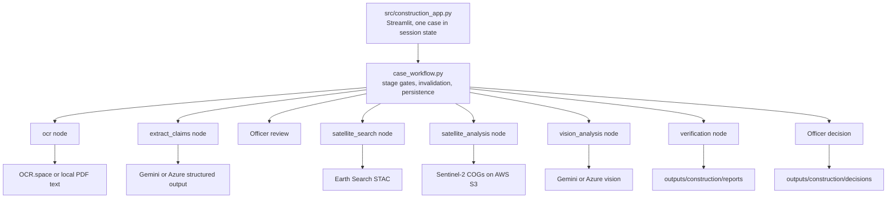

# Construction Claim Verification

A dashboard that helps a government officer check a contractor's construction claim against Sentinel-2 satellite imagery. The software gathers and explains evidence. Only the officer decides, and the AI never authorizes payment.

## Five-stage workflow

| Stage | What happens | External service in production |
| :--- | :--- | :--- |
| 1. Upload | Accepts PDF, PNG, JPG or JPEG and shows the extracted text. Digital PDFs are read locally. | OCR.space for images and scanned PDFs |
| 2. Review details | The AI model extracts project name, contractor, type, coordinates, dates, claims and payment amount. The officer corrects and confirms them. | Gemini or Azure |
| 3. Satellite images | Finds before and after Sentinel-2 L2A scenes and shows scene IDs, dates and cloud cover. | Element84 Earth Search STAC |
| 4. Analyze claims | Rasterio and NumPy compute NDVI and BSI. The vision model assesses each claim from the two images. | AWS S3 imagery, Gemini or Azure |
| 5. Report and decision | Shows all evidence and limitations. The officer records APPROVE, REJECT, REQUEST_INSPECTION or HOLD. | None |

## Architecture



Streamlit calls the LangGraph stages directly, so no FastAPI process is needed. The officer's review is the checkpoint between extraction and retrieval. A decision file stores the SHA-256 of the report it was based on and is kept apart from the AI evidence.

## Setup

Dependencies must already be installed in `.venv`. Copy `.env.example` to `.env` and set these values.

| Variable | Required | Purpose |
| :--- | :--- | :--- |
| `USE_FAKE_MODEL` | Yes | Must be `false` for real use. `true` produces only labelled synthetic test data. |
| `CONSTRUCTION_LLM_PROVIDER` | No | `gemini` (default) or `azure` |
| `GEMINI_API_KEY` | For Gemini | Extraction and vision |
| `CONSTRUCTION_AZURE_API_KEY`, `CONSTRUCTION_AZURE_ENDPOINT`, `CONSTRUCTION_AZURE_DEPLOYMENT` | For Azure | Extraction and vision |
| `CONSTRUCTION_AZURE_VISION_DEPLOYMENT` | No | Separate Azure deployment for vision |
| `OCR_API_KEY` | For images and scanned PDFs | OCR.space |
| `GEMINI_MODEL`, `GEMINI_FALLBACK_MODEL` | No | Model selection |
| `EARTH_SEARCH_URL`, `EARTH_SEARCH_COLLECTION`, `MAX_CLOUD_COVER` | No | Scene search |
| `CONSTRUCTION_OUTPUT_DIR` | No | Uploads, images, reports and decisions |

## Run

```powershell
uv run --no-sync streamlit run src/construction_app.py
```

This command makes real API calls with the credentials in `.env`.

## Test without API calls

The guard in `tests/network_guard.py` loads automatically for every test.

```powershell
$env:UV_OFFLINE = "1"
uv run --offline --no-sync pytest tests/agents/construction_verification/ tests/app/test_construction_routing.py tests/app/test_construction_ui.py -v
```

To open the dashboard with external access blocked and synthetic data:

```powershell
uv run --offline --no-sync python tests/run_app_offline.py --server.port 8599
```

## Verification status

**Verified live on 31 October 2026.** Three uploads ran through the real app in a real browser, using OCR.space, Earth Search, Sentinel-2 imagery on AWS and Azure `gpt-4.1`:

- A runway claim photo, where visible site preparation and pavement work were `SUPPORTED`.
- A road letter as a JPG and as a 2.8 MB PNG, which was shrunk automatically to fit the OCR.space limit. Neither produced a `SUPPORTED` finding.

**Verified with mocks or synthetic data only:**

- Failure handling for OCR, the model, STAC and raster reads.
- Corrupt uploads, missing coordinates and invalid officer input.
- Retries for temporary failures, and the Gemini provider path.

**Not tested live:**

- Scanned PDFs through OCR.space, and the Gemini provider.
- Accuracy across a meaningful set of sites. Three uploads of two documents show that the pipeline runs, not how often its findings are right.

## Sentinel-2 limitations

- Resolution is about 10 m per pixel. Fine features, thin layers and narrow drains may not be visible.
- Sub-surface work, reinforcement, material quality and engineering compliance cannot be seen.
- Vegetation loss shows that the surface changed. It does not prove that the claimed work was done.
- Clouds, seasons and scene dates up to 60 days from the target can affect the result.

## Launching

`src/construction_app.py` is the dashboard. `src/streamlit_app.py` shows the same dashboard when the construction agent is selected, but it also needs the FastAPI service running.

## Human approval safeguard

No code path turns an AI result into a payment. Each decision requires an officer identifier and a justification. Recorded decisions cannot be overwritten through the app, and a decided case is locked. A `SUPPORTED` finding is evidence for review, not approval.

## Known limitations

- The search area is a fixed box of ±0.005° around one coordinate, not the true site boundary.
- Disturbed area is spectral change at 10 m per pixel and is not a surveyed area.
- A case is held in the browser session. Reports, decisions and uploads persist as files, but an in-progress case cannot be resumed.
- The OCR.space free plan accepts files up to 1.5 MB. Images are shrunk automatically, but larger scanned PDFs are rejected with a clear error.
- OCR.space can time out intermittently. The app retries up to three times, then shows the error so the officer can try again.
- A `SUPPORTED` claim or visible progress result is downgraded when under 5% of the analysed box lost vegetation. This threshold was set from only two test sites, and narrow work on bare land can fall below it, so a downgrade means unconfirmed rather than contradicted.
- The vision model is not deterministic. The same road claim returned `NOT_SUPPORTED` in one run and `INSUFFICIENT_EVIDENCE` in another, so treat findings as prompts for review.
- Earth Search metadata declares a `-0.1` radiometric offset, but pixels in the four scenes checked were already corrected, so the app does not subtract it. Other scenes were not checked.
- Small models can miss claims. In testing, `gpt-4.1-nano` merged an itemized schedule into one claim, while `gpt-4.1` returned all seven physical items, so use `gpt-4.1` or stronger.
- `USE_FAKE_MODEL=true` still produces a report, which is clearly labelled `SYNTHETIC_TEST_DATA`.

## Other code in this repository

This project grew from a general agent toolkit. `src/streamlit_app.py`, `src/construction_ui.py`, the FastAPI service, independent construction discovery and drone evaluation remain in the repository, but the dashboard does not load them. The older `src/construction_ui.py` still contains a demo case and a rule-based extraction fallback, so use it only for reference.

## Deploying to Streamlit Community Cloud

Set the main file path to `src/construction_app.py`. Dependencies come from `src/requirements.txt`, a trimmed list for the dashboard only. In the app's Secrets panel, set `USE_FAKE_MODEL`, `OCR_API_KEY`, `GEMINI_API_KEY` (the settings loader needs one recognised LLM key), `CONSTRUCTION_LLM_PROVIDER`, `CONSTRUCTION_AZURE_API_KEY`, `CONSTRUCTION_AZURE_ENDPOINT`, `CONSTRUCTION_AZURE_DEPLOYMENT` and `CONSTRUCTION_AZURE_VISION_DEPLOYMENT`. Uploads, reports and decisions are stored on the host's disk and can be lost when the app restarts.
