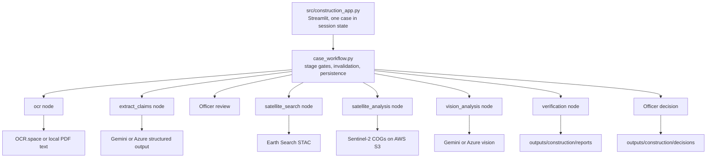

# Construction Claim Verification

A dashboard that helps a government officer check a contractor's construction claim against Sentinel-2 satellite imagery. The software gathers and explains evidence. Only the officer decides, and the AI never authorizes payment.

## Five-stage workflow

| Stage | What happens | External service in production |
| :--- | :--- | :--- |
| 1. Upload | Accepts PDF, PNG, JPG or JPEG and shows the extracted text. Digital PDFs are read locally. | OCR.space for images and scanned PDFs |
| 2. Review details | The AI model extracts project name, contractor, type, coordinates, dates, claims and payment amount. The officer corrects and confirms them. | Gemini or Azure |
| 3. Satellite images | Finds before and after Sentinel-2 L2A scenes and shows scene IDs, dates and cloud cover. | Element84 Earth Search STAC |
| 4. Analyze claims | Rasterio and NumPy compute NDVI and BSI. The vision model assesses each claim from the two images. | AWS S3 imagery, Gemini or Azure |
| 5. Report and decision | Shows all evidence and limitations. The officer records APPROVE, REJECT, REQUEST_INSPECTION or HOLD. | None |

## Architecture



Streamlit calls the LangGraph stages directly, so no FastAPI process is needed. The officer's review is the checkpoint between extraction and retrieval. A decision file stores the SHA-256 of the report it was based on and is kept apart from the AI evidence.

## Setup

Dependencies must already be installed in `.venv`. Copy `.env.example` to `.env` and set these values.

| Variable | Required | Purpose |
| :--- | :--- | :--- |
| `USE_FAKE_MODEL` | Yes | Must be `false` for real use. `true` produces only labelled synthetic test data. |
| `CONSTRUCTION_LLM_PROVIDER` | No | `gemini` (default) or `azure` |
| `GEMINI_API_KEY` | For Gemini | Extraction and vision |
| `CONSTRUCTION_AZURE_API_KEY`, `CONSTRUCTION_AZURE_ENDPOINT`, `CONSTRUCTION_AZURE_DEPLOYMENT` | For Azure | Extraction and vision |
| `CONSTRUCTION_AZURE_VISION_DEPLOYMENT` | No | Separate Azure deployment for vision |
| `OCR_API_KEY` | For images and scanned PDFs | OCR.space |
| `GEMINI_MODEL`, `GEMINI_FALLBACK_MODEL` | No | Model selection |
| `EARTH_SEARCH_URL`, `EARTH_SEARCH_COLLECTION`, `MAX_CLOUD_COVER` | No | Scene search |
| `CONSTRUCTION_OUTPUT_DIR` | No | Uploads, images, reports and decisions |

## Run

```powershell
uv run streamlit run src/construction_app.py
```

This command makes real API calls with the credentials in `.env`.

## Test without API calls

The guard in `tests/network_guard.py` loads automatically for every test.

```powershell
$env:UV_OFFLINE = "1"
uv run --offline --no-sync pytest tests/agents/construction_verification/ tests/app/test_construction_routing.py tests/app/test_construction_ui.py -v
```

To open the dashboard with external access blocked and synthetic data:

```powershell
uv run --offline --no-sync python tests/run_app_offline.py --server.port 8599
```

## Verification status

**Verified with local mocks.** These paths ran with OCR.space, Gemini, STAC and raster reads replaced by fixtures:

- OCR text reaching extraction, and extracted details reaching the review form.
- Officer coordinate and date edits reaching the scene search, and stale results being invalidated.
- Construction and serialization of the Gemini Vision request, including both image payloads.
- Failure handling for OCR, Gemini, STAC and raster reads.
- All five stages driven through the app with Streamlit's `AppTest`, new-case reset, and decision recording.

**Verified with deterministic unit tests.** These ran on synthetic arrays or local GeoTIFF files:

- NDVI and BSI formulas, vegetation loss and disturbed area, and cloud masking.
- Warping rasters from two UTM zones onto one grid.

**Not tested live during the rescue work.** No request was sent to any of these services:

- Gemini extraction and Gemini Vision, including whether the configured model accepts the schema.
- Azure extraction and vision, including whether a deployment supports images and tool calling.
- OCR.space, Earth Search STAC, and Sentinel-2 imagery on AWS S3.

An authorized user should run one known case through the app and check the results before relying on it.

## Sentinel-2 limitations

- Resolution is about 10 m per pixel. Fine features, thin layers and narrow drains may not be visible.
- Sub-surface work, reinforcement, material quality and engineering compliance cannot be seen.
- Vegetation loss shows that the surface changed. It does not prove that the claimed work was done.
- Clouds, seasons and scene dates up to 60 days from the target can affect the result.

## Human approval safeguard

No code path turns an AI result into a payment. Each decision requires an officer identifier and a justification. Recorded decisions cannot be overwritten through the app, and a decided case is locked. A `SUPPORTED` finding is evidence for review, not approval.

## Known limitations

- Sentinel-2 processing-baseline radiometric offsets are not corrected, so comparing scenes across baselines may bias BSI and NDVI values.
- The search area is a fixed box of ±0.005° around one coordinate, not the true site boundary.
- Disturbed area is spectral change at 10 m per pixel and is not a surveyed area.
- A case is held in the browser session. Reports, decisions and uploads persist as files, but an in-progress case cannot be resumed.
- OCR.space limits file size and, on the free tier, page count.
- `USE_FAKE_MODEL=true` still produces a report, which is clearly labelled `SYNTHETIC_TEST_DATA`.

## Other code in this repository

This project grew from a general agent toolkit. `src/streamlit_app.py`, `src/construction_ui.py`, the FastAPI service, independent construction discovery and drone evaluation remain in the repository, but the dashboard does not load them. The older `src/construction_ui.py` still contains a demo case and a rule-based extraction fallback, so use it only for reference.
