# 🛰️ Remote Sensing AI Construction Verification & Discovery Platform

An AI-assisted remote sensing and geospatial audit platform designed for government infrastructure oversight, public works auditing, and independent site discovery. Combines multi-temporal **Sentinel-2 L2A (ESA)** satellite imagery, **GDAL/rasterio** windowed COG streaming, and **Google Gemini Multimodal Vision** with strict human-in-the-loop authorization.

---

## 🔍 Capabilities & Honest System Status

### ✅ What Works in Production Today
- **Document Ingestion & OCR**: Automated OCR text extraction from contractor reimbursement letters, completion certificates, and milestone claims (PDF & images).
- **Structured Claim Extraction**: Pydantic extraction of individual milestone claims, geographic coordinates, and reported work periods.
- **Zero-Credential Sentinel-2 Streaming**: Streams Cloud-Optimized GeoTIFFs (COGs) directly from Element84 AWS STAC (`sentinel-2-l2a`) without requiring AWS credentials via `rasterio.Env(AWS_NO_SIGN_REQUEST="YES", GDAL_DISABLE_READDIR_ON_OPEN="EMPTY_DIR", VSI_CACHE=True)`.
- **Pre- & Post-Works Raster Alignment**: Aligns Red, Green, Blue, NIR, SWIR (B11), and Scene Classification Layer (SCL) rasters onto a shared 10m UTM coordinate reference system.
- **Spectral Index Change Detection**:
  - **NDVI** (Normalized Difference Vegetation Index): $\Delta \text{NDVI} = \text{NDVI}_{\text{after}} - \text{NDVI}_{\text{before}}$ identifies vegetative clearance.
  - **BSI** (Bare Soil Index): Dynamic analytical calculation using SWIR16, Red, NIR, and Blue bands identifies newly exposed earth and concrete paving.
- **Target ROI Cloud & SCL Masking**: Filters invalid pixels (cloud shadow, high/medium cloud, thin cirrus) strictly within the target area of interest (AOI) rather than whole-scene averages.
- **STAC Self-Correction & Window Widening**: Automatically iterates STAC candidates when cropped AOI invalid pixels exceed 30%, and widens search dates by $\pm 30$ days if no clear scene exists.
- **Multi-Temporal Persistence Check (Seasonality Filter)**: Evaluates a 3rd confirmation scene (3–12 months later) to separate persistent construction from seasonal crop cycles (harvesting).
- **Structured Gemini Vision Assessment**: Strict Pydantic output taxonomy (`CONSTRUCTION`, `AGRICULTURAL_HARVEST`, `WATER_BODY`, `CLOUD_OR_ARTIFACT`, `UNCLEAR`) validating against input candidate IDs.
- **OpenStreetMap Ground-Truth Validation**: Script `scripts/validate_osm.py` correlates detected polygons against live OpenStreetMap infrastructure with verified spatial overlap statistics.
- **Human-in-the-Loop Gate**: Enforces officer review, required justifications, and digital signatures; zero automated fund disbursements.

### ⚠️ Known Limitations & Boundaries
- **10m Spatial Resolution**: Sentinel-2 pixel size is $10 \times 10\text{ m}$. Sub-resolution features such as road curbs, rebar reinforcement, drainage culverts, or asphalt layer thickness cannot be verified via satellite alone and require high-resolution drone inspection or on-site audit.
- **Seasonality in 2-Scene Runs**: A 2-scene analysis cannot definitively distinguish between earthworks clearing and seasonal crop harvesting without an optional 3rd confirmation scene.
- **Drone Integration Scope**: Drone evaluation is performed by analyzing uploaded high-resolution drone imagery; the system does not physically dispatch drone hardware.

---

## 🏛️ System Architecture

```mermaid
flowchart TD
    subgraph ModeA ["Mode A: Contractor Claim Verification (LangGraph)"]
        A1[Uploaded Document / Invoice] --> A2[Document OCR Text]
        A2 --> A3[Extract Milestone Claims & Coordinates]
        A3 --> A4[Retrieve Sentinel-2 Pre/Post Scenes via STAC]
        A4 --> A5[Gemini Multimodal Claim-by-Claim Vision Analysis]
        A5 --> A6[Synthesize Recommended Action]
        A6 --> A7{Officer Human Approval Gate}
        A7 -->|Signed| A8[Disbursement Decision Recorded]
    end

    subgraph ModeB ["Mode B: Independent Construction Discovery"]
        B1[Geographic Centroid & Search Radius] --> B2[STAC Scene Search with Auto-Retry & Date Expansion]
        B2 --> B3[Windowed COG Alignment: RGB + NIR + SWIR + SCL]
        B3 --> B4[Masked Δ NDVI & Δ BSI Spectral Change Detection]
        B4 --> B5[Vectorize Contiguous Change Polygons >= 5,000 m²]
        B5 --> B6[Structured Gemini Vision Classification Taxonomy]
        B6 --> B7[Optional 3-Scene Multi-Temporal Persistence Check]
        B7 --> B8[Export Georeferenced GeoJSON & Evidence Audit JSON]
    end
```



---

## 📊 Live Benchmark: Noida International Airport (Jewar)

The benchmark below was executed against real Sentinel-2 satellite imagery streaming from Element84 STAC over Noida International Airport, Jewar, Uttar Pradesh (`28.17° N, 77.61° E`, radius: 5 km).

| Benchmark Parameter | Value | Details |
| :--- | :--- | :--- |
| **Pre-Construction Scene** | `S2A_43RGM_20210320_1_L2A` | `2021-03-20` (0.0% cloud) |
| **Post-Construction Scene** | `S2B_43RGM_20250324_0_L2A` | `2025-03-24` (0.0% cloud) |
| **Coordinate Reference System** | `EPSG:32643` (UTM Zone 43N) | 10.0 meters native spatial resolution |
| **Raster Grid Extent** | `1020 x 1025 pixels` | Approx. 10.2 km × 10.25 km area |
| **Raw Detected Change Area** | **`2,169.3 ha`** | `21,692,800 m²` with $\Delta \text{NDVI} < -0.15$ |
| **Total Candidates Formed** | **`15` zones** | Discrete clusters $\ge 5,000\text{ m}²$ |
| **Candidate 1 (CANDIDATE-01)** | `539.80 ha` | $\Delta \text{NDVI}: -0.306$, $\Delta \text{BSI}: +0.128$ |
| **Candidate 2 (CANDIDATE-02)** | `109.39 ha` | $\Delta \text{NDVI}: -0.493$, $\Delta \text{BSI}: +0.152$ |
| **OpenStreetMap Aeroway Overlap** | **`100.0%` (17/17)** | All known airport aeroway features intercepted |
| **Candidate Precision vs OSM** | **`80.0%` (12/15)** | Candidates directly overlapping verified infrastructure |
| **Pipeline Processing Runtime** | **`138.9 seconds`** | End-to-end STAC read, spectral analysis, vectorization |

*Full benchmark and spatial metrics are documented in [docs/BENCHMARK_JEWAR.md](docs/BENCHMARK_JEWAR.md) and [docs/validation_jewar.md](docs/validation_jewar.md).*

---

## 🚀 Quickstart & Setup

### Prerequisites
- Python 3.11, 3.12, 3.13, or 3.14
- `uv` (recommended) or standard `pip`
- Google Gemini API key ([Google AI Studio](https://aistudio.google.com/))

### 1. Clone & Configure Environment

```bash
git clone https://github.com/your-org/forge.git
cd forge

# Copy configuration template
cp .env.example .env
```

Ensure your `.env` contains:
```env
# Required for Multimodal Gemini Vision
GOOGLE_API_KEY=your_gemini_api_key_here

# STAC Satellite Endpoints (Default Element84 AWS public catalog)
EARTH_SEARCH_URL=https://earth-search.aws.element84.com/v1
EARTH_SEARCH_COLLECTION=sentinel-2-l2a

# Set to false to enforce live Sentinel-2 and Gemini API calls
USE_FAKE_MODEL=false
```

### 2. Install Dependencies

Using `uv`:
```bash
uv sync
```

Or using standard `pip`:
```bash
python -m venv .venv
source .venv/bin/activate  # On Windows: .venv\Scripts\activate
pip install -e .
```

### 3. Run the Applications

**Run the Backend Service (FastAPI on Port 8080):**
```bash
uv run python src/run_service.py
```

**Run the Web Application (Streamlit on Port 8501):**
```bash
uv run streamlit run src/streamlit_app.py
```

Open your browser at `http://localhost:8501`.

---

## 🧪 Running the Verification & Validation Suites

### Unit & Integration Tests
```bash
# Run discovery unit tests
uv run pytest tests/agents/construction_verification/test_discovery.py -v

# Run UI & routing tests
uv run pytest tests/app/test_construction_ui.py tests/app/test_construction_routing.py -v

# Run full test suite
uv run pytest tests/ -v
```

### OpenStreetMap Ground-Truth Validation
```bash
uv run python scripts/validate_osm.py
```

### Live Jewar Airport Benchmark
```bash
uv run python scripts/run_jewar_benchmark.py
```

---

## 🔒 Security & Data Integrity
- **Zero Credentials Required for Satellite Data**: Sentinel-2 L2A rasters are streamed anonymously from Element84 via AWS S3 open data protocols.
- **Audited Provenance**: Every generated report records scene identifiers, acquisition timestamps, cloud percentages, and byte lengths.
- **Human Responsibility**: Machine learning outputs serve exclusively as evidence synthesis. Final approval requires explicit human authorization.
