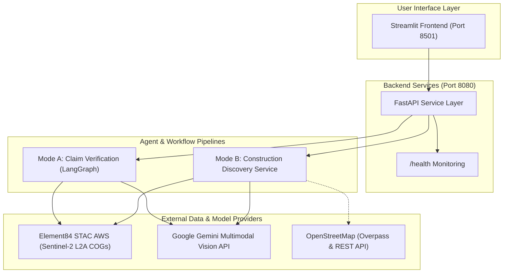
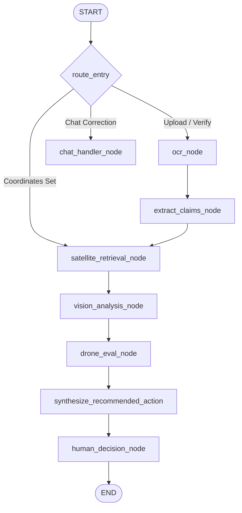
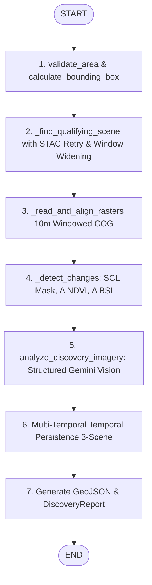
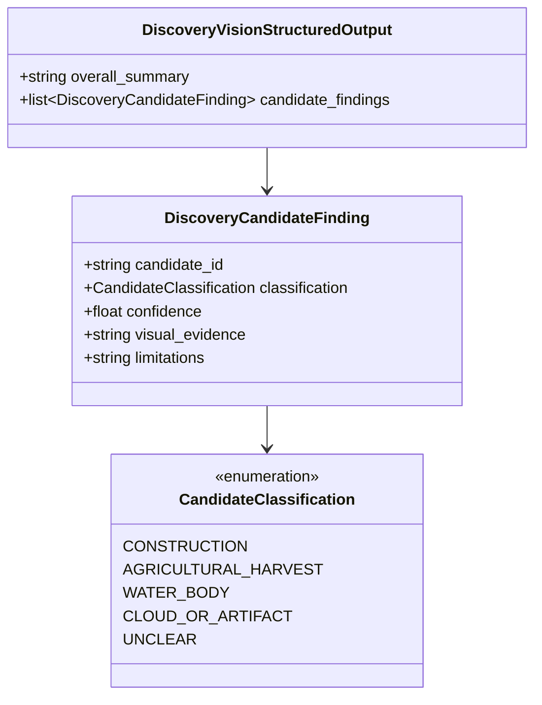

# System Architecture: AI Construction Verification & Discovery

This document provides the complete technical architecture reference for the Construction Verification and Independent Discovery platform.

The system operates in two strictly separated workflows:
1. **Mode A — Contractor Claim Verification**: Human-in-the-loop verification of uploaded contractor reimbursement bills, tender documents, and completion certificates against multi-temporal satellite evidence.
2. **Mode B — Independent Construction Discovery**: Autonomous satellite change detection discovering and classifying new infrastructure, earthworks, and land disturbance without requiring any contractor document or pre-existing claims.

---

## 1. High-Level System Architecture



---

## 2. Mode A — Contractor Claim Verification (LangGraph)

Mode A ingests contractor bills, extracts milestone claims and project coordinates, checks satellite change metrics, runs multimodal vision verification, and provides decision recommendations. Payment approval is **strictly human-certified**; no funds are ever autonomously disbursed.

### Workflow Graph



### Mode A Nodes & Responsibilities

| Node | Type | Description |
| :--- | :--- | :--- |
| `route_entry` | Deterministic | Routes incoming user input based on intent (new document, chat coordinate update, or satellite run). |
| `ocr_node` | Hybrid (OCR/Deterministic) | Extracts raw text from uploaded PDF/image invoices using Tesseract or Gemini OCR. |
| `extract_claims_node` | LLM (Structured) | Extracts structured milestone claims, project coordinates, and construction dates from raw OCR text. |
| `chat_handler_node` | LLM / Deterministic | Allows the officer to correct missing fields, adjust coordinates, or ask audit questions in natural language. |
| `satellite_retrieval_node` | Deterministic | Queries Earth Search STAC for cloud-free pre/post Sentinel-2 scenes and calculates spectral change. |
| `vision_analysis_node` | Multimodal LLM | Submits before/after RGB satellite crops to Gemini Vision to evaluate each contractor claim. |
| `drone_eval_node` | Multimodal LLM | Analyzes optional high-resolution drone photography for sub-resolution structural features. |
| `human_decision_node` | Human Gate | Enforces human officer approval; captures digital signature, decision notes, and approval timestamp. |

### Mode A State Schema (`ConstructionVerificationState`)

```python
class ConstructionVerificationState(TypedDict):
    cv_case_id: str
    officer_id: str
    document_path: str | None
    ocr_text: str
    project_name: str | None
    construction_type: str | None
    bounding_box: list[float] | None  # [min_lon, min_lat, max_lon, max_lat]
    date_range: tuple[str, str] | None  # (start_date, completion_date)
    construction_claims: list[dict[str, Any]]
    satellite_metrics: dict[str, Any] | None
    verification_results: list[dict[str, Any]] | None
    drone_requested: bool
    drone_image_path: str | None
    drone_findings: list[dict[str, Any]] | None
    recommended_action: dict[str, Any] | None
    officer_decision: dict[str, Any] | None
    audit_trail: list[dict[str, Any]]
```

---

## 3. Mode B — Independent Construction Discovery

Mode B independently identifies visible construction changes across a geographic region (e.g. Noida International Airport) without requiring any uploaded document, pre-existing contractor claims, or chat state.

### Discovery Workflow



### Self-Correction & Reliability Mechanisms

1. **ROI Valid Pixel Quality Check**: Rather than relying only on whole-scene metadata cloud cover, Mode B reads the Sentinel-2 Scene Classification Layer (SCL) over the exact cropped target bounding box. If invalid pixels (cloud shadow, cloud medium/high, thin cirrus) exceed **30%**, the scene is rejected, and the next STAC candidate is evaluated.
2. **Search Window Auto-Expansion**: If no scene qualifies within the requested dates, the search window automatically widens by $\pm 30$ days once. All attempted scenes and rejection reasons are permanently documented in `report.retrieval_attempts`.
3. **Multi-Temporal Persistence Check (Seasonality Filter)**: To distinguish permanent construction from seasonal agricultural crop cycles (harvesting), an optional confirmation scene (3–12 months later) is evaluated:
   - **Persistent Change (Construction)**: $\Delta \text{NDVI}_{1 \to 2} \le -0.15$ and vegetation remains suppressed in Scene 3 ($\text{NDVI}_3 - \text{NDVI}_1 \le -0.10$ and $\text{NDVI}_3 - \text{NDVI}_2 < 0.15$).
   - **Seasonal Crop Harvest**: Vegetation rebounds in Scene 3 ($\text{NDVI}_3 - \text{NDVI}_2 \ge 0.15$). Candidates with $\ge 55\%$ seasonal recovery are automatically re-classified as `AGRICULTURAL_HARVEST`.
   - **2-Scene Advisory**: When only 2 scenes are provided, the report explicitly states: *"2-scene analysis: cannot distinguish permanent construction from seasonal crop cycles without a confirmation scene. Use caution with agricultural areas."*

---

## 4. Structured Output Taxonomy & Validation

Gemini Vision outputs are strictly constrained via Pydantic schemas using `llm.with_structured_output(DiscoveryVisionStructuredOutput)`:



### Hallucination Guardrails
- **Raster-Derived Coordinates**: All polygon bounding boxes, centroids, and areas are computed deterministically via Shapely and rasterio from the georeferenced satellite grid. Coordinates are never generated by the LLM.
- **Candidate ID Validation**: If the model outputs findings for candidate IDs not present in the input list, they are discarded with a warning. Any input candidate missing from the model's response is defaulted to `UNCLEAR` with confidence `0.5`.
- **Failure Auditing (`VISION_NOT_EXECUTED`)**: If the API call fails or quota is exceeded, the audit record logs `parsed_response_status = "VISION_NOT_EXECUTED"`, `vision_actually_executed = False`, and candidate classifications remain `UNCLEAR` rather than generating hallucinated summaries.

---

## 5. Deterministic vs. LLM Component Boundary

| Component | Nature | Implementation |
| :--- | :--- | :--- |
| Bounding box calculation | **Deterministic** | Geographic math via haversine/degrees approximation |
| STAC scene discovery & filtering | **Deterministic** | Element84 STAC API query & metadata filtering |
| Windowed COG raster streaming | **Deterministic** | rasterio with `AWS_NO_SIGN_REQUEST="YES"` |
| Cloud & shadow masking | **Deterministic** | Sentinel-2 SCL classes `{0, 1, 3, 8, 9, 10}` |
| Spectral index calculation (NDVI, BSI) | **Deterministic** | NumPy array arithmetic |
| Contiguous cluster vectorization | **Deterministic** | rasterio `shapes()` & Shapely polygon operations |
| Temporal persistence masking | **Deterministic** | Multi-temporal 3-scene NumPy mask intersection |
| OpenStreetMap ground-truth validation | **Deterministic** | Shapely geometric intersections with Overpass/OSM features |
| Document OCR text parsing | **Hybrid** | OCR engine text extraction |
| Milestone claim extraction | **LLM** | Gemini structured output |
| Visual verification of surface features | **Multimodal LLM** | Gemini Vision multimodal prompt with dual PNG bytes |
| Final payment disbursement authorization | **Human Gate** | Human officer digital signature |

